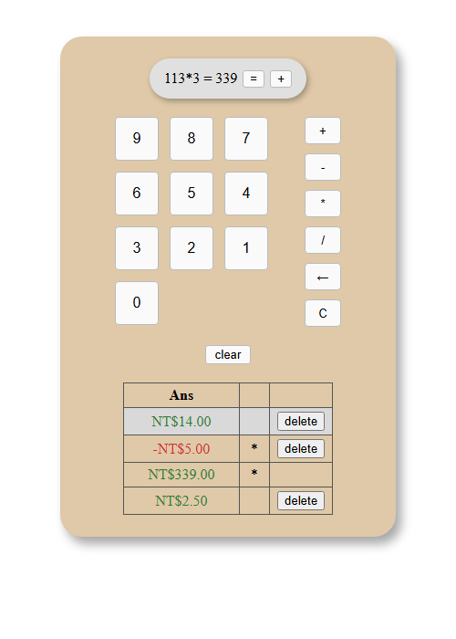

# Angular 計算機：從零開始的手把手教學

> 對象：**完全沒有寫過網頁**的新手。
> 目標：用最新的 Angular（本教學使用 **Angular 22**）完成一個「計算機」專案，並學會專業開發者每天使用的工具：VS Code、ESLint、Prettier、Git、單元測試。

## 怎麼使用這份教學

1. **照順序讀**。每一章都建立在前一章的成果上。
2. **自己動手打程式碼**，不要只複製貼上。打錯字、看到紅線、修好它，都是學習的一部分。
3. 每章最後都有「✅ 檢查點」。畫面跟描述一樣才進下一章。
4. 每章結束都會 `git commit`，萬一改壞了，隨時可以回到上一章的狀態。

## 目錄

| 章 | 主題 | 你會學到 | 預估時間 |
|---|---|---|---|
| [00](00-spec.md) | 開發規格書 | 我們要做出什麼（先看過，之後隨時回來查） | 20 分 |
| [01](01-environment.md) | 安裝開發環境 | Node.js、VS Code、Git、終端機 | 40 分 |
| [02](02-create-project.md) | 建立 Angular 專案 | `ng new`、專案資料夾導覽、`ng serve` | 30 分 |
| [03](03-vscode-lint-format.md) | VS Code、ESLint、Prettier | 存檔自動排版、自動抓錯 | 45 分 |
| [04](04-html-css-basics.md) | HTML / CSS 速成 | 標籤、屬性、class、排版（flex / grid）、表格 | 60 分 |
| [05](05-angular-basics.md) | Angular 基礎 | 元件、`{{ }}`、`(click)`、signal、class 綁定 | 45 分 |
| [06](06-components-layout.md) | 拆元件與版面 | `ng generate component`、組出計算機外觀 | 60 分 |
| [07](07-parent-child.md) | 父子元件溝通 | `input()`、`output()`、按鍵輸入算式 | 60 分 |
| [08](08-calculator-logic.md) | 計算邏輯 | `=` 計算、`←` 刪除、`C` 清空、除以 0 | 60 分 |
| [09](09-result-table.md) | 計算結果 table | `@for`、條件樣式、台幣格式、`delete`、`clear` | 60 分 |
| [10](10-testing-and-wrapup.md) | 測試與收尾 | Vitest 單元測試、正式建置、驗收、FAQ | 60 分 |

## 卡住的時候

- 先看該章的「⚠️ 常見錯誤」。
- 看 VS Code 下方的「問題（Problems）」面板，以及終端機的紅字。**錯誤訊息通常已經告訴你答案**，把它從頭讀一遍。
- 用 `git diff` 看看自己改了什麼。
- 最後一章有整理好的 [FAQ](10-testing-and-wrapup.md#常見問題-faq)。

## 版本資訊

| 工具 | 本教學使用的版本 |
|---|---|
| Node.js | 24.x（LTS） |
| npm | 11.x |
| Angular / Angular CLI | 22.x |
| TypeScript | 6.0 |
| 測試工具 | Vitest（Angular 預設） |
| ESLint | 10.x（`angular-eslint` 22.x） |
| Prettier | 3.x |
